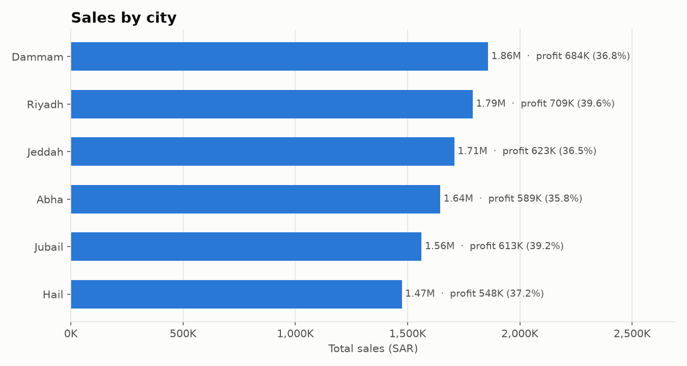
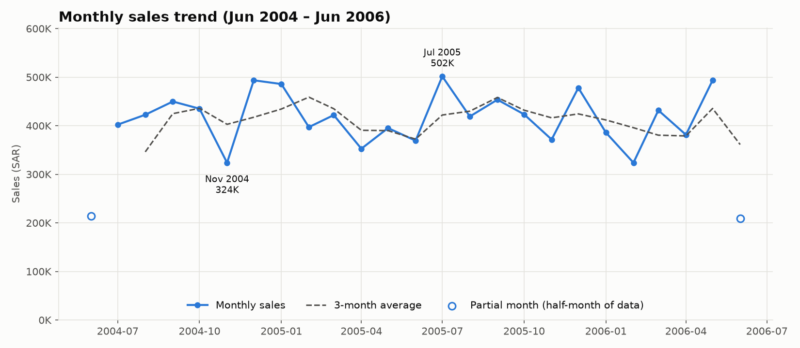
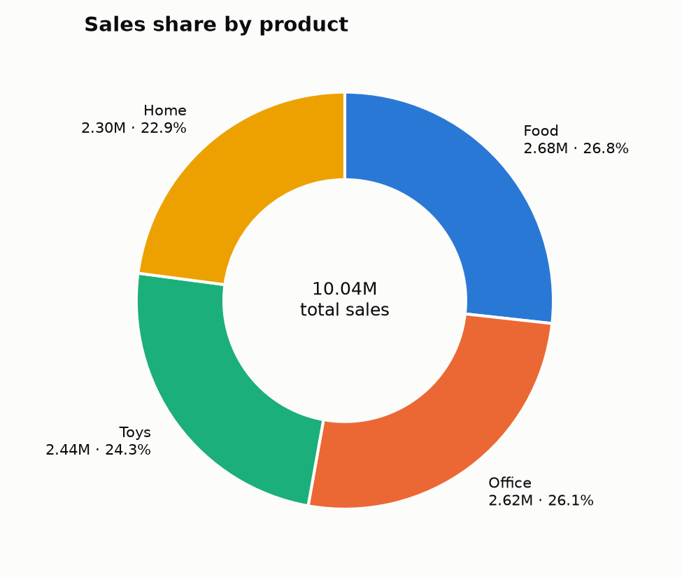
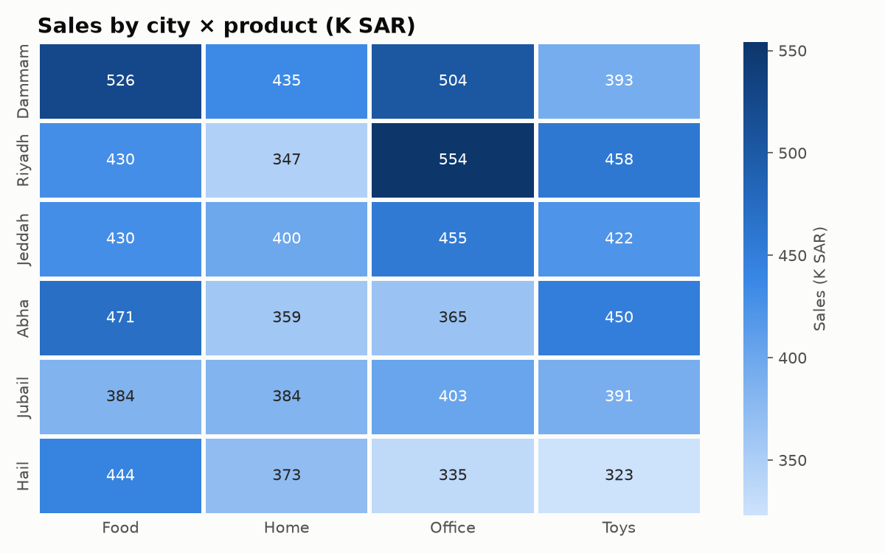
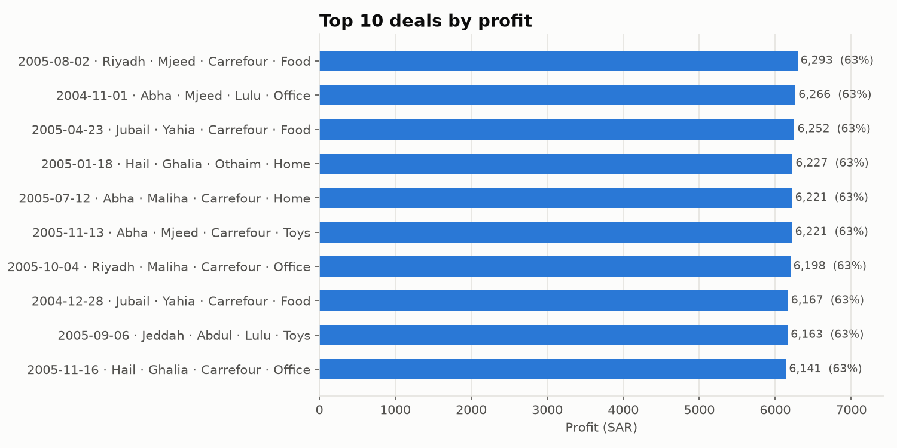
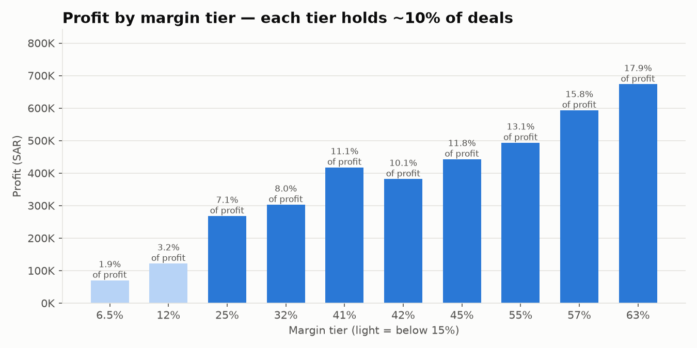

# Kafaat — تحليل مبيعات المدن السعودية

مشروع تحليل بيانات كامل لملف مبيعات `Kafaat.csv`:
تنظيف ← تحليل استكشافي ← رسوم بيانية ← نموذج توقع ← لوحة تفاعلية ← نسخة سحابية على BigQuery و Looker Studio.

| المؤشر | القيمة |
|---|---|
| الفترة | 2004-06-17 → 2006-06-16 |
| الصفقات (بعد التنظيف) | 1,992 من 1,998 |
| إجمالي المبيعات | 10,035,789 ريال |
| إجمالي الربح | 3,766,212 ريال |
| هامش الربح | 37.5% |

الرؤى والتوصيات الكاملة في **[output/insights.md](output/insights.md)**.

### 🌐 الموقع (GitHub Pages)

**🔗 [maram-almutairi.github.io/kafaat-sales-analytics](https://maram-almutairi.github.io/kafaat-sales-analytics/)**

صفحة المشروع باللغة الإنجليزية وبنفس تصميم البورتفوليو، وفيها:
- لوحة تفاعلية لبيانات كفاءات: فلاتر، مؤشرات KPI، رسوم بيانية، جداول، وتحميل البيانات النظيفة.
- **تحليل أي ملف مبيعات آخر (CSV أو Excel):** اختر *Upload my own file*، ثم حدد أعمدة التاريخ والمبيعات والتكلفة وأعمدة التجميع. الأعمدة تُكتشف تلقائياً حتى لو كانت عناوينها بالعربي. الملف يُنظّف بنفس قواعد `01_clean.py` ويظهر تقرير بالصفوف المحذوفة.
- **الخصوصية:** الملف يُحلَّل داخل متصفح الزائر فقط ولا يُرفع لأي سيرفر.
- الرؤى الخمس والتوصيات والمنهجية.

الصفحة ملف ثابت (`index.html` + `site/`)، بدون مكتبات خارجية: الرسوم مكتوبة بـ JavaScript، ومكتبة قراءة Excel (SheetJS 0.20.3) محفوظة داخل الـ repo.

---

## 1. خطة التنفيذ

| # | المرحلة | الملف | المخرجات |
|---|---|---|---|
| 1 | تنظيف البيانات | `scripts/01_clean.py` | `data/Kafaat_Cleaned.csv`, `output/cleaning_report.md` |
| 2 | التحليل الاستكشافي | `scripts/02_eda.py` | `output/*_summary.csv`, `monthly_trend.csv`, `margin_tiers.csv` |
| 3 | الرسوم البيانية | `scripts/03_visualization.py` | `output/figures/*.png` |
| 4 | نموذج التوقع | `scripts/04_ml_model.py` | `output/ml_*.csv`, `07_feature_importance.png` |
| 5 | لوحة المعلومات | `dashboard/app.py` | تطبيق Streamlit |
| 6 | السحابة | `sql/*.sql` | جداول BigQuery + Looker Studio |

### تعديلات على الخطة (تعارض مع البيانات أو بين المتطلبات)

1. **الأعمدة المشتقة:** الهيكل يطلب `Kafaat_Cleaned.csv` "بدون إضافة أعمدة"، والمتطلبات تطلب إضافة Profit و Margin_% و Year و Month و Weekday.
   ⇐ الملف النظيف يحتفظ بالأعمدة السبعة الأصلية فقط، والأعمدة المشتقة تُحسب في `scripts/utils.py → load_clean()` (وفي BigQuery عبر view `v_sales`) حتى يحسبها الجميع بنفس الطريقة.
2. **تواريخ شاذة:** 3 صفوف بتاريخ 2014–2015 بينما باقي البيانات 2004–2006 ⇐ حُذفت كأخطاء إدخال.
3. **أخطاء إملائية:** `Mjeeed` ⇐ `Mjeed` و `Lulu Hyper` ⇐ `Lulu` (صُححت ولم تُحذف).
4. **أشهر جزئية:** يونيو 2004 ويونيو 2006 فيهما نصف شهر فقط ⇐ مُعلَّمة في الاتجاه الشهري ومستبعدة من النموذج.
5. **مستوى التوقع:** 23 شهراً كاملاً فقط لا تكفي لتدريب نموذج، لذلك يتدرب النموذج على **مدينة × شهر** (138 نقطة) ثم تُجمع النتائج. أُضيف نموذج بسيط (Naive) للمقارنة.
6. **إضافات:** `scripts/utils.py` (دوال مشتركة)، `store_summary.csv`، `margin_tiers.csv`، `city_product_matrix.csv`، ورسم مستويات الهامش، لأن مستويات الهامش الثابتة هي أهم اكتشاف في البيانات.

---

## 2. هيكل المشروع

```
kafaat/
├── data/
│   ├── Kafaat.csv                 الملف الأصلي
│   └── Kafaat_Cleaned.csv         الملف النظيف (7 أعمدة، التاريخ بصيغة YYYY-MM-DD)
├── scripts/
│   ├── utils.py                   قواعد التنظيف clean_raw() + load_clean() + summarize()
│   ├── 01_clean.py                التنظيف + تقرير الصفوف المحذوفة (القواعد في utils.clean_raw)
│   ├── 02_eda.py                  التحليل الاستكشافي + الجداول الملخصة
│   ├── 03_visualization.py        6 رسوم بيانية
│   └── 04_ml_model.py             Linear Regression + Random Forest
├── sql/
│   ├── 01_create_table.sql        الجدول الخام + الجدول النظيف + view التحليل
│   ├── 02_eda_queries.sql         استعلامات التحليل
│   └── 03_advanced_queries.sql    Window Functions + BigQuery ML
├── dashboard/
│   └── app.py                     Streamlit Dashboard (نسخة Python محلية)
├── output/
│   ├── city_summary.csv  rep_summary.csv  store_summary.csv  product_summary.csv
│   ├── monthly_trend.csv  margin_tiers.csv  city_product_matrix.csv
│   ├── ml_metrics.csv  ml_feature_importance.csv  ml_forecast.csv
│   ├── cleaning_report.md  eda_log.txt
│   ├── insights.md                الرؤى والتوصيات
│   └── figures/                   01..07 *.png
├── index.html                     صفحة GitHub Pages
├── site/                          style.css + app.js + vendor/xlsx.full.min.js + logo.png
├── README.md
└── requirements.txt
```

---

## 3. التشغيل

```bash
python -m venv .venv
.venv\Scripts\activate            # Windows   (Linux/Mac: source .venv/bin/activate)
pip install -r requirements.txt

python scripts/01_clean.py
python scripts/02_eda.py
python scripts/03_visualization.py
python scripts/04_ml_model.py

streamlit run dashboard/app.py    # http://localhost:8501
```

الترتيب مهم، لأن كل خطوة تقرأ مخرجات الخطوة التي قبلها.

---

## 4. التنظيف

| الخطوة | المحذوف | السبب |
|---|---:|---|
| Cost أو Sale فارغ | 2 | قيمة فارغة / مسافات فقط |
| قيم شاذة | 1 | Cost = 50,000,000 (خارج Q3 + 3×IQR) |
| تواريخ شاذة | 3 | 2014–2015 بعيدة 8 سنوات عن باقي البيانات |
| مكررات | 0 | — |
| **المجموع** | **6 (0.3%)** | |

- تحويل التاريخ: `Excel serial → 1899-12-30 + n يوم`.
- تنظيف الأرقام: حذف المسافات والفواصل ثم التحويل لرقم.
- التقرير الكامل مع الصفوف المحذوفة في `output/cleaning_report.md`.

---

## 5. أهم النتائج

| البُعد | الأعلى مبيعاً | الأعلى ربحاً / هامشاً | الأضعف |
|---|---|---|---|
| المدينة | الدمام 1.86M | الرياض 709K (39.6%) | حائل 1.47M |
| المندوب | Yahia 2.17M | Ghalia هامش 38.6% | Abdul 1.82M (36.5%) |
| المتجر | كارفور 2.62M | بنده هامش 38.4% | كارفور أقل هامش 36.8% |
| المنتج | Food 2.68M | Office هامش 38.1% | Home 2.30M |

- **الهامش يقع على 10 مستويات ثابتة**، و21.4% من الصفقات هامشها تحت 15%. هذه الصفقات تمثل 20.9% من المبيعات لكن 5.1% فقط من الربح.
- **لا نمو:** السنة الثانية أقل بـ 0.65% من الأولى.
- **التوقع ليونيو 2006:** ≈ 414 ألف ريال (Random Forest)، والخطأ المتوقع ≈ ±50 ألف.

### الرسوم

| | |
|---|---|
|  |  |
|  |  |
|  |  |

---

## 6. النشر على السحابة (BigQuery + Looker Studio)

### أ) BigQuery

1. أنشئ مشروعاً في [Google Cloud Console](https://console.cloud.google.com/) وفعّل **BigQuery API**.
2. ثبّت [Google Cloud CLI](https://cloud.google.com/sdk/docs/install) ثم:
   ```bash
   gcloud auth login
   gcloud config set project <PROJECT_ID>
   ```
3. أنشئ الـ dataset والجدول الخام (أول جزأين من `sql/01_create_table.sql`):
   ```bash
   bq mk --location=US kafaat
   ```
4. ارفع الملف الأصلي **كما هو** (كل الأعمدة STRING، والتنظيف يتم داخل BigQuery):
   ```bash
   bq load --source_format=CSV --skip_leading_rows=1 --replace \
     kafaat.sales_raw data/Kafaat.csv \
     Date:STRING,City:STRING,Rep:STRING,Store:STRING,Prod:STRING,Cost:STRING,Sale:STRING
   ```
5. نفّذ باقي `sql/01_create_table.sql` في BigQuery Console. ينتج عنه:
   - `kafaat.sales_clean`: جدول نظيف مقسّم (partitioned) بالشهر ومجمّع (clustered) بالمدينة والمنتج
   - `kafaat.v_sales`: view فيه Profit و Margin_Pct و Year و Month و Weekday

   استعلام التدقيق في آخر الملف يجب أن يعطي `rows_clean = 1992`.
6. نفّذ `sql/02_eda_queries.sql` و `sql/03_advanced_queries.sql`. الاستعلام 9 في الملف الأخير يدرّب نموذج **BigQuery ML ARIMA_PLUS** للتوقع داخل السحابة.

### ب) Looker Studio

1. افتح [lookerstudio.google.com](https://lookerstudio.google.com) ← **Create → Report**.
2. **Add data → BigQuery** ← المشروع ← `kafaat` ← `v_sales`.
3. أنشئ حقولاً محسوبة (Calculated fields) حتى يكون الهامش صحيحاً عند التجميع:
   - `Margin %` = `SUM(Profit) / SUM(Sale)` (النوع Percent)
   - `Low-margin deals %` = `SUM(CASE WHEN Margin_Pct < 15 THEN 1 ELSE 0 END) / COUNT(Sale)`
4. العناصر المقترحة (نفس لوحة Streamlit):
   - **Scorecards:** Total Sales, Total Profit, Margin %, Record Count, Low-margin deals %
   - **Bar:** City × SUM(Sale)
   - **Time series:** YearMonth × SUM(Sale)
   - **Donut:** Prod × SUM(Sale)
   - **Pivot table + heatmap:** City × Prod
   - **Table:** أعلى 10 صفقات حسب Profit
   - **Controls:** Date range + drop-downs لـ City و Rep و Store و Prod
5. **Share** ← أضف إيميلات الإدارة أو **Get report link** ← اختر الصلاحية (Viewer).
6. لتحديث البيانات تلقائياً: أعد تحميل `sales_raw` ثم أعد إنشاء `sales_clean` عبر **Scheduled query** في BigQuery (مثلاً يومياً).

---

## 7. نشر ومشاركة اللوحة

| الطريقة | الوصف |
|---|---|
| **GitHub Pages** (المستخدَم حالياً) | Settings ← Pages ← Source = *Deploy from a branch*، Branch = `main` / `(root)`. أي `git push` جديد يحدّث الموقع خلال دقيقة. |
| Streamlit (محلياً) | `streamlit run dashboard/app.py`: نسخة Python من اللوحة بنفس قواعد التنظيف. |
| Looker Studio | القسم 6 أعلاه: بدون كود، ويُشارك برابط. |

## 8. المكتبات

`pandas`, `numpy`, `matplotlib`, `seaborn`, `scikit-learn`, `streamlit`, `plotly`. التفاصيل في `requirements.txt` (تم الاختبار على Python 3.12).
